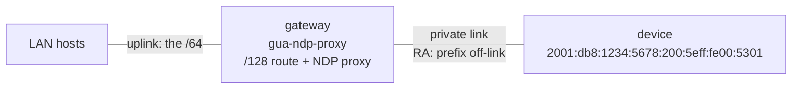

# gua-ndp-proxy

Give a device behind a private link — a USB network gadget, a Bluetooth PAN
bridge — a real, routable IPv6 address, without NAT and without putting it on
the LAN's wire.



The gateway advertises its uplink's /64 on each downstream link as *off-link*,
so a device SLAACs a global address in it but still routes through the
gateway. This daemon notices each device, installs a `/128` host route towards
its link, and answers neighbor solicitations for it on the uplink. LAN hosts
can then reach the device directly at its own address.

See [docs/design.md](docs/design.md) for the full reasoning and
[docs/troubleshooting.md](docs/troubleshooting.md) for symptoms and causes.

## Quick start

Requires Linux, Python 3.9+, iproute2, iputils `ping`, and systemd for the
supplied unit. Building needs Meson and Ninja.

```sh
meson setup build --prefix=/usr
meson test -C build
sudo meson install -C build

sudo install -d /etc/gua-ndp-proxy
sudo cp /usr/share/doc/gua-ndp-proxy/examples/gua-ndp-proxy.conf /etc/gua-ndp-proxy/
sudoedit /etc/gua-ndp-proxy/gua-ndp-proxy.conf     # set uplink, downstream
sudo systemctl enable --now gua-ndp-proxy
```

You also need to advertise the /64 off-link on each downstream link
(`examples/downstream-link.network`) and set a few sysctls; see
[docs/installation.md](docs/installation.md) and
[docs/configuration.md](docs/configuration.md). Preview what it would do with
`gua-ndp-proxy --uplink eth0 --downstream usb0 --dry-run --once -v`.

## Limitations

- The device's global address is derived from its link-local one, so devices
  must use the same interface identifier for both (EUI-64 does). Devices with
  per-address random or stable-privacy identifiers are not found.
- It does not change what is advertised downstream; if your upstream prefix
  changes, update the advertisements.
- IPv6 only, a single /64.
- Downstream links must be trusted. Read [SECURITY.md](SECURITY.md) before
  deploying.

## Status

Pre-1.0. The approach was developed with small embedded Linux devices on USB
gadget Ethernet and Bluetooth PAN links. This packaged version is covered by
unit tests and an integration test that runs against a real kernel inside a
network namespace; it has not yet been re-run against physical hardware.

## Contributing

See [CONTRIBUTING.md](CONTRIBUTING.md). Security issues: [SECURITY.md](SECURITY.md).

## License

[MIT](LICENSE)
